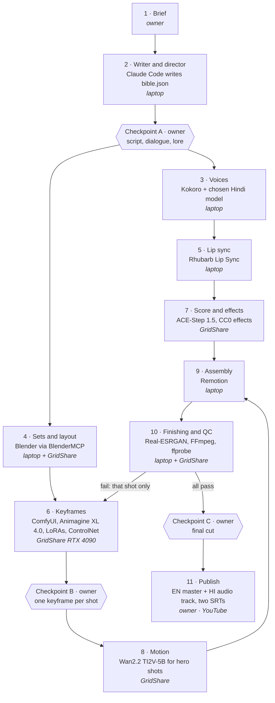
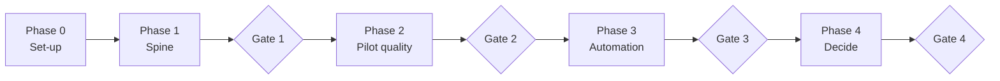

# Workplan

The plan this repository follows, decided on 3 October 2026. It mirrors the
Claude doc *AI Film Studio — Refined Workplan & Workflow*
(<https://claude.ai/code/artifact/b69a278a-f30f-491d-ab05-d7e0e1918809>, private
to the owner). Claude Code works from this file: tick a step only when its
done-test has passed.

There are **no dates**. A phase ends when its gate passes.

---

## 1. Goal

Publish 5–7 minute episodes of an original anime series — fantasy, sci-fi and
supernatural, grounded at first — for a general audience on YouTube, each with
English and Hindi dialogue, each built by the pipeline from one Production
Bible file, with the owner's work reduced to three approvals.

| Measure per episode | Target |
|---|---|
| Owner's work | Three approvals, nothing else |
| Commands from approved Bible to both masters | 1 |
| Full re-renders | 0 — every repair is per shot |
| Shots retouched by hand | 0 |
| GPU spend | ≤ ₹1,000 |

**Why 5–7 minutes, not 20:** a 20-minute episode is roughly 200 shots. Short
episodes teach the same pipeline lessons at a fraction of the cost and give
retention data first. Longer episodes are decided at Gate 4.

**Out of scope until Gate 4:** text-to-video for whole episodes, character
animation in Blender, a dashboard, genre templates, a one-prompt interface,
a multi-cloud scheduler, automatic YouTube upload, other platforms.

---

## 2. Decisions

| Question | Answer | Consequence |
|---|---|---|
| Audience and genre | General audience; fantasy, sci-fi, supernatural, grounded at first | Not made for kids. Needs a series bible, consistent characters, dialogue, lip sync |
| Languages | English and Hindi | One video per episode with a Hindi audio track (YouTube multi-language audio); one SRT per language, never burned in; minimal on-screen text |
| Voices | Best open-source CPU voice | Kokoro for English, one voice per character; Hindi chosen by a bake-off (step 1.4) |
| Visual route | Anime-like generated images and video | Animagine XL 4.0 keyframes, Wan2.2 image-to-video for hero shots, Blender sets for consistent locations |
| Owner's time | About 10 hours a week | Sets the pace only; no deadlines |
| Budget | ₹8,000 a month, excluding Claude Pro | Not binding: expected ₹1,500–3,000 a month |
| Compute | GridShare (India) for heavy jobs; light jobs on the laptop | See section 7 |
| Purpose | The owner's own channel first | No multi-user features before Gate 4 |
| Hindi review | The owner judges it | Checkpoints A and C include a Hindi read-through and listen-through |
| Automation | Maximum | Everything mechanical is automated; three approvals stay, because YouTube does not monetise mass-produced content and story continuity needs a human eye |

---

## 3. Roles

| Role | Claude does | The owner keeps |
|---|---|---|
| Producer and project manager | Plans, tracks cost and progress, prepares gate reviews | The gate decision |
| Writer and director | Season arc, scripts and dialogue in both languages, shot lists | Checkpoint A |
| Researcher and lore keeper | Series bible; checks every script against it | — |
| Art director and continuity | Style bible, character sheets, checks every shot against references | Approves each character design once |
| AI generation operator | ComfyUI workflows, prompts, seeds, LoRA training, image-to-video | — |
| 3D technical artist | Blender sets and cameras through BlenderMCP; depth and line-art passes | — |
| Voice director | One voice per character per language, pronunciation lists, transcription checks, lip-sync timing | Final ear on Hindi |
| Composer and sound mixer | Music prompts, ducking under dialogue, loudness | — |
| Editor and motion designer | Remotion timeline, subtitles, titles | Checkpoint C |
| Pipeline engineer | All code and tests, GridShare start/stop scripts, review page | Runs commands on the laptop when Claude cannot |
| QC lead | Automated technical QC; inspects frames and contact sheets | Watches each draft once |
| Rights clerk | Licence record for every model, voice and track | Legal sign-off before monetising |
| Distribution and marketing | Titles, descriptions, chapters, tags, end screens, thumbnails, Shorts, both languages | Upload, audience setting, AI declaration |
| Archivist | Versions, manifests, reproducibility records | — |
| Owner | — | GridShare, YouTube and payment accounts |

**What Claude cannot do:** hear audio (dialogue is checked by transcribing it
back; the owner judges the voice); watch motion in real time (flicker is caught
by frame-difference measures and at Checkpoint C); reach GridShare or the
laptop's Blender from a cloud workspace (those steps run through Claude Code
on the laptop).

---

## 4. Episode pipeline

Sound runs down the left, picture down the right. Every stage reads only the
Bible and the asset registry, writes only its own assets, and records what it
did.

Phase 1 builds a thin version: voices, keyframes, assembly and QC. Phase 2
plugs in sets, character models, lip sync, motion, score and upscaling.

---

## 5. Phases and gates

| Gate | Passes when |
|---|---|
| Gate 1 | One command turns a brief into both MP4s, and a one-shot repair leaves every other shot untouched |
| Gate 2 | Episode 1 is public, and every shot passed Checkpoint B with no manual retouching |
| Gate 3 | An episode goes from brief to upload-ready files with only the three approvals and no full re-render |
| Gate 4 | The next scope is chosen from data: long form, Blender characters, automatic upload |

---

## 6. Build steps

Status values: **Not started · In progress · In review · Done · Blocked.**
"Claude" means Claude in this repository: in a cloud workspace for code, and
through Claude Code on the laptop for anything touching GridShare or Blender.

### Phase 0 · Set-up

| # | Step | Who · where | Tools | Done when | Status |
|---|---|---|---|---|---|
| 0.1 | Install Node.js (LTS), FFmpeg and Git; Python is already there through Anaconda | Owner · laptop | winget or installers | `node -v`, `ffmpeg -version`, `git --version` print versions (today `npx` is missing) | Not started |
| 0.2 | Install Claude Code and clone the repository | Owner · laptop | Claude Code, Git | Claude Code runs `python scripts/create_project.py doctor` | Not started |
| 0.3 | Create the GridShare account, add an SSH key, install the CLI | Owner · GridShare | `gridshare` CLI | `gridshare list` answers | Not started |
| 0.4 | Confirm which storage persists (docs list ₹6/GB/month volumes; the pricing page says none) | Owner asks; Claude reads | GridShare support | A file saved before a stop survives a restart | Not started |
| 0.5 | Cut `CLAUDE.md` under 200 lines; open the `spine` branch | Claude · workspace | GitHub | Owner merges the pull request | In review |

### Phase 1 · Spine

| # | Step | Who · where | Tools | Done when | Status |
|---|---|---|---|---|---|
| 1.1 | Production Bible schema: Project, Character, Location, Scene, Shot, Line, Asset, Job | Claude · workspace | JSON Schema, `studio validate` | Rejects 5 deliberately broken Bibles, accepts 1 valid one | Done (`tests/test_bible.py`) |
| 1.2 | Test episode Bible: 10-shot grounded opening scene, two characters, English and Hindi dialogue | Claude drafts; owner approves (Checkpoint A) | `examples/ep00/bible.json` | `studio validate ep00` passes and the owner approves the Hindi | Drafted, awaiting Checkpoint A |
| 1.3 | English voice worker, one Kokoro voice per character | Claude · laptop | Kokoro-82M, Whisper | Each clip, transcribed back, matches its script line | Not started |
| 1.4 | Hindi voice bake-off | Claude runs; owner picks | Indic Parler-TTS, Chatterbox Hindi, Kokoro Hindi | Owner chooses one voice | Not started |
| 1.5 | Hindi voice worker | Claude · laptop or GridShare | Chosen model, Whisper | Round-trip transcription matches the Hindi script | Not started |
| 1.6 | Placeholder image worker | Claude · laptop | Pillow | Whole pipeline runs with no GPU | Not started |
| 1.7 | Remotion composition that reads the Bible | Claude · laptop | Remotion, Node.js | One MP4 and one SRT per language; no caption outlasts its shot | Not started |
| 1.8 | One-command build: `studio build ep00 --lang en,hi` | Claude · laptop | `studio` CLI | Exits cleanly from a fresh clone | Not started |
| 1.9 | GPU control: `studio gpu up` / `studio gpu down` | Claude · laptop | GridShare CLI | A test job runs and the instance stops itself | Not started |
| 1.10 | Image worker with a locked style prompt | Claude · GridShare | ComfyUI, Animagine XL 4.0, RTX 4090 | Owner approves 10 keyframes (Checkpoint B) | Not started |
| 1.11 | Asset registry | Claude · laptop | `assets` in the Bible | Every frame in a render traces to an asset ID, version and licence | Not started |
| 1.12 | Selective regeneration: `studio regen ep00 SH003 --image` / `--voice hi` | Claude · laptop + GridShare | `studio` CLI | Only that shot's files change; every other checksum is identical | Not started |
| 1.13 | Technical QC | Claude · laptop | ffprobe, FFmpeg | Catches 5 deliberately seeded faults | Not started |
| 1.14 | Director: brief to Bible with a validate-and-retry loop | Claude · laptop | Claude Code, `studio validate` | 3 briefs give 3 valid Bibles with no hand edits | Not started |

### Phase 2 · Pilot quality

| # | Step | Who · where | Tools | Done when | Status |
|---|---|---|---|---|---|
| 2.1 | Series bible: world rules, magic and technology systems, tone ladder from grounded to supernatural, season arc, main cast | Claude drafts; owner approves | `series/` | Owner approves; every later script is checked against it | Not started |
| 2.2 | Character sheets for the main cast | Claude · GridShare; owner approves once | ComfyUI, Animagine XL 4.0 | Owner approves each design | Not started |
| 2.3 | Character LoRAs, one per main character | Claude · GridShare | kohya_ss | 20 new images per character keep the same face and outfit | Not started |
| 2.4 | Location sets and camera layouts | Claude · laptop, renders on GridShare | Blender, BlenderMCP | A location matches itself across 5 camera angles | Not started |
| 2.5 | Guided keyframes over the Blender passes | Claude · GridShare | ComfyUI, ControlNet, LoRAs | Owner picks one per shot (Checkpoint B) | Not started |
| 2.6 | Hero-shot motion | Claude · GridShare | Wan2.2 TI2V-5B | No visible flicker or morphing | Not started |
| 2.7 | Lip sync | Claude · laptop | Rhubarb Lip Sync, Remotion | Mouths follow the dialogue in both languages | Not started |
| 2.8 | Score and sound effects | Claude · GridShare (₹12/hr card) | ACE-Step 1.5, CC0 effects | Loudness check passes; music ducks under dialogue | Not started |
| 2.9 | Upscaling | Claude · GridShare | Real-ESRGAN anime models | No visible artefacts at full screen | Not started |
| 2.10 | Review page: approve or reject each shot; a reject queues its regeneration | Claude · laptop | Local web page | One reject regenerates only that shot | Not started |
| 2.11 | Episode 1 end to end | Claude; owner at three checkpoints | Full pipeline | Owner publishes it | Not started |

### Phase 3 · Automation

| # | Step | Who · where | Tools | Done when | Status |
|---|---|---|---|---|---|
| 3.1 | Job queue with resume | Claude · laptop | SQLite | A run killed halfway resumes without redoing finished jobs | Not started |
| 3.2 | GPU batching: start, run all queued GPU jobs, sync, stop | Claude · laptop | GridShare CLI / API | No instance left running after a batch | Not started |
| 3.3 | Automated visual QC against character, location and style references | Claude · laptop | Claude vision, frame metrics | Flags 5 deliberately seeded defects | Not started |
| 3.4 | Distribution pack in both languages | Claude · workspace | — | Owner uploads with no edits | Not started |
| 3.5 | Episodes 2 and 3 through the full pipeline | Claude; owner at checkpoints | Full pipeline | The owner's only work was three approvals each | Not started |

### Phase 4 · Decide

| # | Step | Who · where | Tools | Done when | Status |
|---|---|---|---|---|---|
| 4.1 | Analytics review: retention, views, cost, owner's time, failures | Claude · workspace | YouTube Studio, pipeline logs | Every number traces to a source | Not started |
| 4.2 | Decide: longer episodes, Blender character animation, automatic upload | Owner | Decision log | Each choice recorded with its reason | Not started |

---

## 7. Tool stack, compute and budget

Full details, licences and sources: `integrations/registry.yaml`.

| Stage | Tool | Runs on | Licence (code / weights) | GPU time per episode |
|---|---|---|---|---|
| Writer and director | Claude Code | Laptop | Pro plan | — |
| English voices | Kokoro-82M | Laptop CPU | Apache-2.0 | 0 |
| Hindi voices | Bake-off winner | Laptop, else ₹12/hr card | Apache-2.0 / MIT | ≤ 0.5 h |
| Sets and layout | Blender + BlenderMCP | Laptop; renders on GridShare | MIT (BlenderMCP) | ~1 h |
| Character models | kohya_ss | GridShare | Apache-2.0 | One-off per character |
| Keyframes | ComfyUI + Animagine XL 4.0 | GridShare RTX 4090 | GPL-3.0 / CreativeML Open RAIL++-M | ~2 h |
| Motion | Wan2.2 TI2V-5B | GridShare RTX 4090 | Apache-2.0 | ~6 h |
| Lip sync | Rhubarb Lip Sync | Laptop | MIT | 0 |
| Score | ACE-Step 1.5 | ₹12/hr card | MIT | Minutes |
| Upscaling | Real-ESRGAN | GridShare | BSD-3-Clause | ~1 h |
| Assembly | Remotion | Laptop | Free for individuals | 0 |
| Finishing and QC | FFmpeg, ffprobe | Laptop | Open source | 0 |

- About 11 GPU hours per episode ≈ ₹530 on an RTX 4090 at ₹48/hr. GridShare
  bills per second after the first minute.
- Start on the RTX 4090, not the RTX 5090: the 50-series needs recent CUDA builds.
- GridShare's largest NVIDIA card has 32 GB, so Wan2.2's 14B models (80 GB) are out.
- GridShare offers SSH and JupyterLab, no remote desktop: BlenderMCP drives
  Blender on the laptop; renders run headless on GridShare.
- Rejected for commercial use: MusicGen and F5-TTS weights (CC-BY-NC); XTTS-v2
  needs its own licence review.

---

## 8. Risks and kill criteria

| Risk | Response |
|---|---|
| Demonetisation as mass-produced content | A distinct story per episode, owner-approved scripts, real motion, characters with their own voices |
| Ads limited for violence or shock | Keep early episodes eerie, not graphic; check each episode and thumbnail against the advertiser-friendly guidelines |
| Wrong audience setting | Always "not made for kids" |
| India's synthetic-content rules (IT Rules amendment, in force 20 Feb 2026) | Declare AI content truthfully; keep model, seed and prompt records as provenance |
| Licences | Record code and weight licences before first use; anime-like style only, never recognisable characters |
| Broken lore | Series bible is the single source of truth; every script checked against it |
| Inconsistent characters | One sheet and one LoRA per main character; clips only from approved keyframes; crowded shots built one character at a time |
| Inconsistent locations | Every location is a Blender set; every shot generated over its passes |
| Lip sync that ignores the audio | Rhubarb mouth shapes, the limited-animation convention |
| BlenderMCP runs arbitrary code | Localhost only; save before each session; set-up scripts in Git |
| Model churn | Swap a worker only at a gate, after a side-by-side test on ep00 and a licence check |

**Kill or pivot:**
- If Gate 1 stalls: cut scope (narrated motion graphics, no generated images) rather than add infrastructure.
- After Episode 2: if the owner's hands-on time is still above 12 hours, stop making episodes and automate the most expensive stage first.
- After Episode 3: if average view duration is under 30% and views are flat, change format or story before longer episodes.

---

## 9. Metrics

Log one row per episode: owner's hours, spend (₹), shots, shots regenerated,
full re-renders, views at 7 days, average view duration (%). Full re-renders
should fall to zero; average view duration says whether the format works.

---

## 10. Open questions

- [ ] What does "grounded at first" mean concretely: setting, era, city?
- [ ] How many main characters appear in Episode 1? (Recommendation: two or three.)
- [ ] Premise: the owner's own, or three drafts from Claude to choose from?
